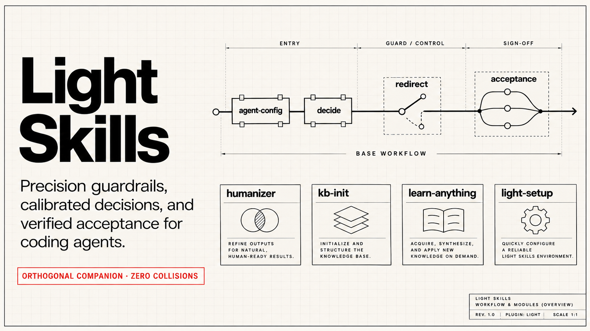

<p align="center">
  <picture>
    <source media="(prefers-color-scheme: dark)" srcset="./assets/header-dark.png">
    <source media="(prefers-color-scheme: light)" srcset="./assets/header-light.png">
    
  </picture>
</p>

<p align="center">
  <strong>English</strong> | <a href="./README.zh-CN.md">简体中文</a>
</p>

# Light Skills

Orthogonal agent skill plugins built to layer cleanly over [`mattpocock/skills`](https://github.com/mattpocock/skills) (the **Base workflow**) with zero duplicate skill names and zero copied files, or to run standalone across any Agent Skills harness with **Graceful fallback**.

## Why Light Skills

General engineering loops (`/grill-with-docs`, `/to-spec`, `/to-tickets`, `/implement`, `/implement-spec`, `/code-review`, `/tdd`, `/pr`) already live in `mattpocock/skills`. `light-cheng/skills` adds the orthogonal capabilities missing around that core without competing in your agent's context window:

- **Zero skill collisions**: No forked Base workflow skills and no `review` naming clash (`acceptance` handles bounded convergence and milestone sign-off while delegating code diffs to `code-review` when installed).
- **Standalone Graceful fallback**: Every cross-collection reference (`code-review`, `research`, `writing-for-agents`, `wizard`) and companion MCP integration (`light-decision-mcp`, `agent-config`) works out of the box when external tools are absent.
- **Pure-skills manifests**: Neither plugin manifest spawns background MCP processes automatically. Companion MCP runtimes bind dynamically when configured.
- **Clean target repositories**: Runtime artifacts (`decisions.md`, `changes/`, `acceptance/`) stay inside `.scratch/`, keeping project roots clean.

## Installation

### 1. Managed Plugin Install (Claude Code, Codex 0.161+, GitHub Copilot)

Register the marketplace and install the default `light` Core plugin (auto-updated by your harness):

```text
/plugin marketplace add light-cheng/skills
/plugin install light@light-cheng
```

Install the optional `light-manuscript` plugin only in workspaces that produce books or multi-format publications:

```text
/plugin install light-manuscript@light-cheng
```

### 2. Universal `npx skills` Install (Claude Code, Codex, Antigravity, Cursor, OpenCode, Pi)

Install all core skills or pick individual skills with the [Agent Skills CLI](https://github.com/vercel-labs/skills):

```bash
# Interactive or full install from the repository
npx skills add light-cheng/skills

# Install a single skill
npx skills add light-cheng/skills --skill acceptance
```

## Plugins & Skills

### Core Plugin: `light` (`skills/{workflow,knowledge,writing}/`)

| Category | Skill | Invocation | What It Does |
| :--- | :--- | :--- | :--- |
| `workflow` | [`light-setup`](./skills/workflow/light-setup/SKILL.md) | User (`/light-setup`) | Idempotently adds a 3-line `## Light workflow` bridge (`redirect` + `acceptance`) to `CLAUDE.md` / `AGENTS.md`, writes `docs/agents/light-project.md` (`Decision data`), and routes Base workflow + Light phase boundaries (`~150k` Smart Zone). |
| `workflow` | [`redirect`](./skills/workflow/redirect/SKILL.md) | Model + `/redirect` | Halts implementation when an approved spec, ticket graph, or charter stops holding, writes a **Change proposal** under `.scratch/<feature>/changes/` or GitHub/GitLab Issues, and waits for human approval before updating `/to-spec` or `/to-tickets`. |
| `workflow` | [`acceptance`](./skills/workflow/acceptance/SKILL.md) | Model + `/acceptance` | Unified convergence and sign-off module: **Inline scale** runs up to 3 fresh-context review-and-repair rounds in memory; **Charter scale** (`init` / `run` / `resume`) freezes an Acceptance charter under `.scratch/<feature>/acceptance/` and dispatches an independent Evaluator. |
| `workflow` | [`agent-config`](./skills/workflow/agent-config/SKILL.md) | Model + `/agent-config` | Profiles task difficulty, capability tiers (`routine`, `standard`, `high`, `review`), and execution topology (`single session` vs `controller-workers`), integrating optional `decide` scores (`DOWNGRADE_MARGIN = 0.15`) and the `agent-config` companion MCP. |
| `workflow` | [`decide`](./skills/workflow/decide/SKILL.md) | Model + `/decide` | **Bounded judgment** frontend (`yes_no`, `choose`, `score`, `decide`, `decide_batch`, `status`) for `light-decision-mcp`, enforcing `Decision data` privacy boundaries (`on-device` default), calibration thresholds, and `.scratch/<feature>/decisions.md` audit logs. |
| `knowledge` | [`kb-init`](./skills/knowledge/kb-init/SKILL.md) | User (`/kb-init`) | Initializes personal or project knowledge bases with explicit date/`repo@commit` claim provenance, `superseded` history markers, and `Ingest / Query / Lint` maintenance loops. |
| `knowledge` | [`learn-anything`](./skills/knowledge/learn-anything/SKILL.md) | User (`/learn-anything`) | Distills primary sources into reusable skills behind the **Method Contract & Source-Sufficiency Gate** (`not_promoted` for one-off summaries, `BLOCKED` for missing evidence) before authoring via `writing-for-agents`. |
| `writing` | [`humanizer`](./skills/writing/humanizer/SKILL.md) | Model + `/humanizer` | Bilingual English/Chinese anti-AI-writing rewriter with register-routed **Technical / Clarity Mode** (ASD-STE100 for English technical docs and concise verb-first Chinese rules, never forced onto essays or narratives). |

### Optional Plugin: `light-manuscript` (`plugins/light-manuscript/`)

| Skill | Invocation | What It Does |
| :--- | :--- | :--- |
| [`manuscript-ops`](./plugins/light-manuscript/skills/manuscript-ops/SKILL.md) | Model + `/manuscript-ops` | End-to-end publishing and manuscript workflow starting from any approved Brief, enforcing source lineage, `needs-v2` routing, **Concept Grounding** reviews, `acceptance` milestone gates, and modular state validation (`schema`, `lineage`, `gates`, `qa`). |

## Optional Companion MCP Servers

Both skills below run standalone in session-local / self-judgment mode by default and light up hardware or multi-backend capabilities when paired with their companion MCP servers:

- **[Light Decision MCP](https://github.com/light-cheng/Light-Decision-MCP)** (`light-decision-mcp`): Multi-backend System One decision router (Magpie gateway, Gemini Decision, TypeSafe Jev, Perplexity Decisions, OpenAI Decisions, and on-device OpenDecider / Ollama / MLX) with `doctor`, `recommend`, `setup`, and loopback web `ui`.
- **[Agent Config MCP](https://github.com/light-cheng/agent-config)** (`agent-config`): Cross-harness host capability inspector, profile store, and preview-before-apply configuration adapter across 10 native agent harnesses.

## Quick Workflow Setup

In a project using `mattpocock/skills` (or standalone):

1. *(Optional)* Run `/setup-matt-pocock-skills` to configure `docs/agents/issue-tracker.md` and `triage-labels.md`.
2. Run `/light-setup setup` to add the `## Light workflow` bridge to `CLAUDE.md` and set `Decision data` (`on-device` by default) in `docs/agents/light-project.md`.
3. Build normally with `/to-spec`, `/to-tickets`, and `/implement` or `/implement-spec`: `redirect` catches invalidated assumptions automatically, and `acceptance` verifies real execution evidence before work closes.

## Development & Verification

```bash
npm install
npm run check:frontmatter
npm run check:plugin-version
npm test
claude plugin validate .
claude plugin validate plugins/light-manuscript
```

For local maintainer symlink development (`skills/<category>/*` by default, add `--with-optional` to include optional plugins under `plugins/`):

```bash
./scripts/link-skills.sh
```

## Attribution & License

Released under the [MIT License](./LICENSE). Third-party upstream notices for `humanizer` (`blader/humanizer`, `op7418/Humanizer-zh`, and Wikipedia CC BY-SA 4.0 examples) are preserved in [`skills/writing/humanizer/ATTRIBUTION.md`](./skills/writing/humanizer/ATTRIBUTION.md).
