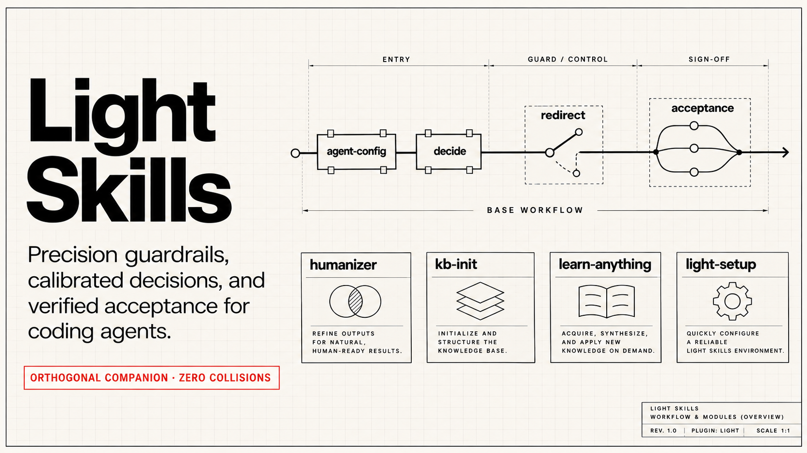

<p align="center">
  <picture>
    <source media="(prefers-color-scheme: dark)" srcset="./assets/header-dark.png">
    <source media="(prefers-color-scheme: light)" srcset="./assets/header-light.png">
    
  </picture>
</p>

<p align="center">
  <a href="./README.md">English</a> | <strong>简体中文</strong>
</p>

# Light Skills

面向编码与知识工作流的正交智能体技能插件集，可与 [`mattpocock/skills`](https://github.com/mattpocock/skills)（**Base workflow** 基础工作流）零冲突叠加使用，也可通过 **Graceful fallback**（优雅降级）在任意兼容 Agent Skills 的宿主中独立运行。

## 设计理念

通用软件工程闭环（`/grill-with-docs`、`/to-spec`、`/to-tickets`、`/implement`、`/implement-spec`、`/code-review`、`/tdd`、`/pr`）由 `mattpocock/skills` 直接承担；`light-cheng/skills` 不复制任何基础工作流文件，只补充正交能力：

- **零技能重名与零上下文竞争**：不复刻上游工程技能，统一将收敛审查与里程碑签收收敛为 `acceptance`（软件代码差异优先委派给已安装的 `code-review`，消除多个 `review` 技能并存的歧义）。
- **独立可用与优雅降级**：所有跨集合引用（`code-review`、`research`、`writing-for-agents`、`wizard`）及伴生 MCP（`light-decision-mcp`、`agent-config`）在未安装时均内置自包含回退路径。
- **纯技能插件清单**：`plugin.json` 不自动拉起任何后台 `mcpServers` 进程，伴生 MCP 按需动态绑定。
- **保持目标仓库根目录整洁**：运行期持久产物（`decisions.md`、`changes/`、`acceptance/`）统一写入 `.scratch/`。

## 安装方式

### 1. 托管插件安装（Claude Code、Codex 0.161+、GitHub Copilot）

添加插件市场并安装默认的 `light` 核心插件（支持宿主自动更新）：

```text
/plugin marketplace add light-cheng/skills
/plugin install light@light-cheng
```

仅在需要长篇书稿或多格式出版流水线的工作区按需安装可选插件 `light-manuscript`：

```text
/plugin install light-manuscript@light-cheng
```

### 2. 通用 `npx skills` 安装（Claude Code、Codex、Antigravity、Cursor、OpenCode、Pi）

使用 [Agent Skills CLI](https://github.com/vercel-labs/skills) 安装全部核心技能或指定单个技能：

```bash
# 从仓库安装技能
npx skills add light-cheng/skills

# 仅安装单个技能
npx skills add light-cheng/skills --skill acceptance
```

## 插件与技能概览

### 核心插件：`light`（`skills/core/`）

| 技能 | 触发方式 | 核心职责 |
| :--- | :--- | :--- |
| [`light-setup`](./skills/core/light-setup/SKILL.md) | 用户调用（`/light-setup`） | 幂等写入 `CLAUDE.md` / `AGENTS.md` 的 3 行 `## Light workflow` 桥接规则（`redirect` + `acceptance`），生成 `docs/agents/light-project.md`（配置 `Decision data` 隐私边界），并提供 **Base workflow + Light** 路由与 `~150k` Smart Zone 上下文边界指南。 |
| [`redirect`](./skills/core/redirect/SKILL.md) | 模型自动 + `/redirect` | 当既定规格、任务图或验收章程在实施中失效时立即暂停修改，依据 `docs/agents/issue-tracker.md` 在 `.scratch/<feature>/changes/` 或 GitHub/GitLab Issues 生成变更提案（**Change proposal**），经人工批准后再衔接 `/to-spec` 或 `/to-tickets`。 |
| [`acceptance`](./skills/core/acceptance/SKILL.md) | 模型自动 + `/acceptance` | 统一收敛与签收模块：**Inline 模式**在内存中执行最多 3 轮全新上下文审查与修复闭环；**Charter 模式**（`init` / `run` / `resume`）在 `.scratch/<feature>/acceptance/` 冻结验收章程，并派发独立全新上下文 Evaluator 核验证据后出具 `PASS`、`FAIL` 或 `BLOCKED`。 |
| [`agent-config`](./skills/core/agent-config/SKILL.md) | 模型自动 + `/agent-config` | 评估任务形态、复杂度档位（`routine`、`standard`、`high`、`review`）与执行拓扑（单会话 vs 主控-工作子代理），支持归一化 `decide` 评分输入（保守降档裕度 `DOWNGRADE_MARGIN = 0.15`）及可选 `agent-config` 伴生 MCP。 |
| [`decide`](./skills/core/decide/SKILL.md) | 模型自动 + `/decide` | `light-decision-mcp` 的原生有界判断（**Bounded judgment**）技能前端（`yes_no`、`choose`、`score`、`decide`、`decide_batch`、`status`），强制执行项目 `Decision data` 数据出境边界（默认 `on-device`）、校准阈值门控与 `.scratch/<feature>/decisions.md` 审计日志。 |
| [`humanizer`](./skills/core/humanizer/SKILL.md) | 模型自动 + `/humanizer` | 中英双语去 AI 腔改写技能，保留完整上游开源署名，并新增按语域路由的**技术清晰模式（Technical / Clarity Mode）**（英文技术文档遵循 ASD-STE100 原则，中文技术文档遵循简明技术中文规范，绝不全局套用于散文或叙事写作）。 |
| [`kb-init`](./skills/core/kb-init/SKILL.md) | 用户调用（`/kb-init`） | 初始化个人或项目知识库，内置事实与代码断言的显式日期 / `repo@commit` 溯源锚点、`superseded` 历史演进标记，以及 `Ingest / Query / Lint` 持续维护机制。 |
| [`learn-anything`](./skills/core/learn-anything/SKILL.md) | 用户调用（`/learn-anything`） | 去脚本化的技能提炼器：先通过方法契约与一手资料充足性门禁（一次性总结记为 `not_promoted`，证据或占位符缺失记为 `BLOCKED`），再调用 `writing-for-agents` 产出标准技能包。 |

### 可选插件：`light-manuscript`（`plugins/light-manuscript/`）

| 技能 | 触发方式 | 核心职责 |
| :--- | :--- | :--- |
| [`manuscript-ops`](./plugins/light-manuscript/skills/manuscript-ops/SKILL.md) | 模型自动 + `/manuscript-ops` | 面向书籍与多格式出版物的全生命周期管理：支持任意经用户批准的 Brief 直接启动，内置资料血缘校验、`needs-v2` 路由、**概念铺垫检查（Concept Grounding）**、`acceptance` 里程碑门禁及模块化状态校验器（`schema`、`lineage`、`gates`、`qa`）。 |

## 可选伴生 MCP 服务

以下两个伴生 MCP 服务均非强制依赖；未安装时技能自动退回会话内规划或模型自判模式，安装后即可解锁硬件感知与多后端能力：

- **[Light Decision MCP](https://github.com/light-cheng/Light-Decision-MCP)**（`light-decision-mcp`）：多后端 System One 决策路由服务（支持 Magpie 网关、Gemini Decision、TypeSafe Jev、Perplexity Decisions、OpenAI Decisions 以及本地 OpenDecider / Ollama / MLX），内置 `doctor`、`recommend`、`setup` 与本地 Web 管理台 `ui`。
- **[Agent Config MCP](https://github.com/light-cheng/agent-config)**（`agent-config`）：跨宿主能力探测、配置档案持久化与先预览后应用（preview-before-apply）的宿主配置适配器，原生支持 10 类主流智能体宿主。

## 快速上手

1. *（可选）* 运行 `/setup-matt-pocock-skills` 配置项目的 `docs/agents/issue-tracker.md` 与 `triage-labels.md`。
2. 运行 `/light-setup setup`，在 `CLAUDE.md` 中写入 `## Light workflow` 桥接片段，并在 `docs/agents/light-project.md` 中设定 `Decision data`（默认 `on-device`）。
3. 按常规流程执行 `/to-spec`、`/to-tickets` 与 `/implement` 或 `/implement-spec`：假设失效时由 `redirect` 自动拦截并生成变更提案，收尾与里程碑交由 `acceptance` 基于真实执行证据完成收敛验收。

## 本地开发与校验

```bash
npm install
npm run check:frontmatter
npm run check:plugin-version
npm test
claude plugin validate .
claude plugin validate plugins/light-manuscript
```

维护者本地软链接调试（默认仅链接 8 个核心技能 `skills/core/*`，传入 `--with-optional` 额外链接 `manuscript-ops`）：

```bash
./scripts/link-skills.sh
```

## 开源协议与致谢

本项目基于 [MIT License](./LICENSE) 开源。`humanizer` 所引用的第三方上游项目与示例署名（`blader/humanizer`、`op7418/Humanizer-zh` 及 Wikipedia CC BY-SA 4.0 引用示例）完整保留于 [`skills/core/humanizer/ATTRIBUTION.md`](./skills/core/humanizer/ATTRIBUTION.md)。
